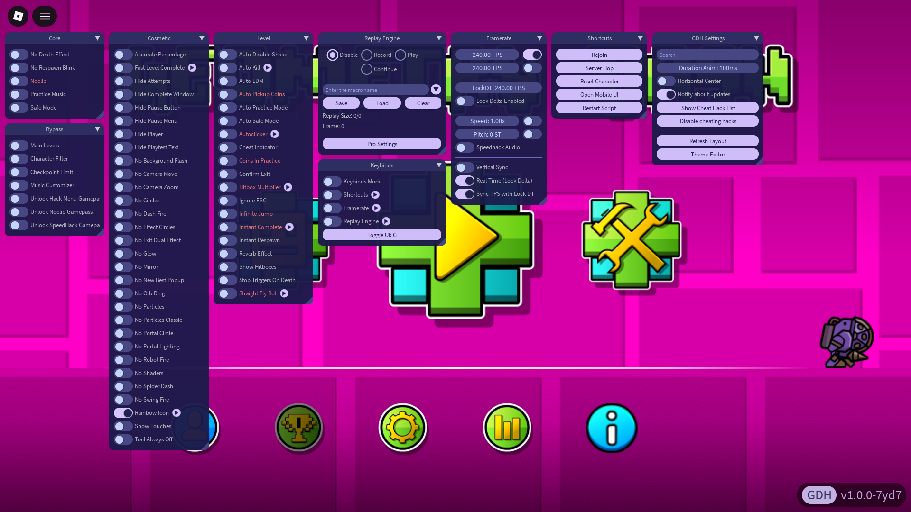
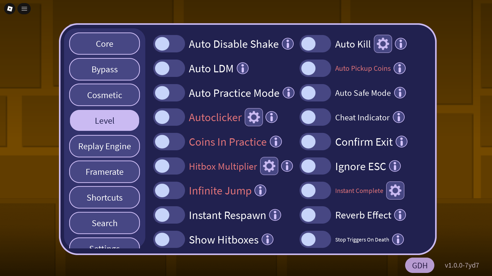

<p align=center>
  
</p>

<h1 align="center">GDH is a mod menu For Roblox Script<br/>Executor</h1>

<p align=center>
  
  
</p>

---

<h3 align="center">Usage</h3>

```luau
loadstring(game:HttpGet("https://raw.githubusercontent.com/7yd7/GDH-Roblox/main/Loader.luau", true))()
```

<h3 align="center">Games</h3>

[Geometry Dash 2.2](https://www.roblox.com/games/128583746271484/Geometry-Dash-2-2)
---

> Warning: This is not official by [GDH](https://gitlab.com/tobyadd/GDH) Original for Geometry Dash
